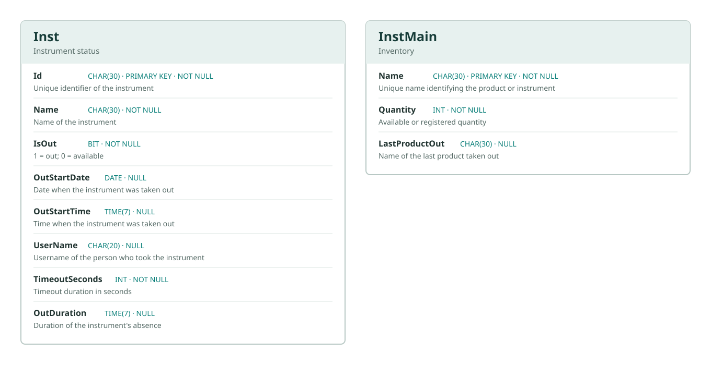

# Eleonetech Product Scanner

## Overview
This project combines LabVIEW, Python, and machine learning to create a comprehensive data analysis and processing application.

## Project Structure

```
├── app.py             # Python camera, YOLO detection, and OCR integration
├── main.vi            # LabVIEW interface
├── my_model.pt        # Trained YOLO model
├── requirements.txt   # Python dependencies
└── SQL.udl            # Windows OLE DB connection configuration
```

## Requirements

### Python Dependencies
- Python 3.7+
- PyTorch (for model execution)
- Additional dependencies as specified in requirements.txt

### Software
- LabVIEW (for `.vi` files)
- Tesseract OCR installed at the path configured in `app.py`
- A database provider/server compatible with the settings in `SQL.udl`, if using the database connection

## Installation

1. Clone or download this repository
2. Install Python dependencies:
   ```bash
   pip install -r requirements.txt
   ```

3. Configure the database connection in `SQL.udl` for your local environment. Do not commit credentials.

4. Load `my_model.pt` in the application

## Usage

### Running the Python Application
```bash
python app.py
```

### LabVIEW
Open `main.vi` in LabVIEW to access the VI interface.

## Database Structure



No foreign key relationship is shown between `Inst` and `InstMain` in the provided schema screenshots.

**Note:** The descriptions are inferred from the column names. Confirm the exact business logic of `Quantity`, `TimeoutSeconds`, and `OutDuration` in your application.

## File Descriptions

- **app.py**: Main Python application logic
- **main.vi**: LabVIEW interface
- **my_model.pt**: Pre-trained PyTorch machine learning model
- **SQL.udl**: Universal Data Link file for external database connection configuration

## Contributing
[Add contribution guidelines as needed]

## License
[Add license information as needed]

## Contact
[Add contact information as needed]
